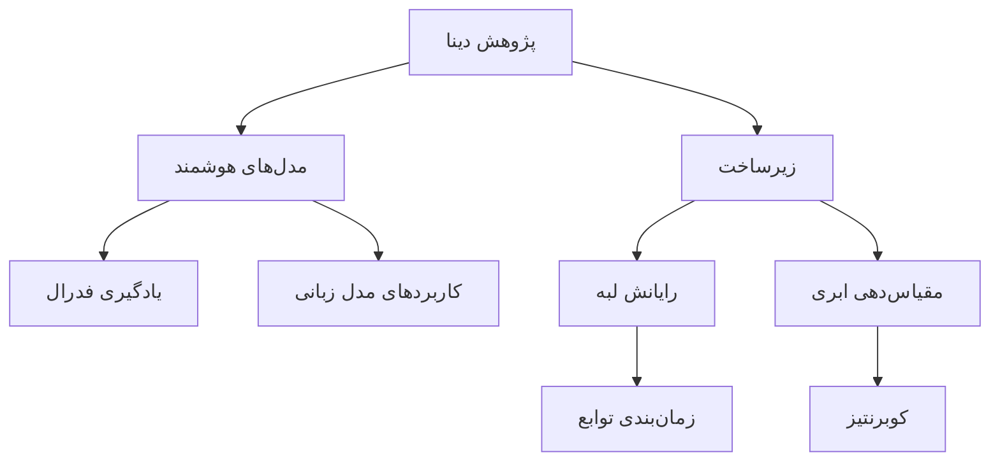

دینا زیرساخت هوشمند را از آموزش مدل تا اجرای زمان‌اجرا — روی دستگاه، لبه و ابر — مطالعه می‌کند. این مطلب هشت راستای پژوهشی ما و خطوط جاری را معرفی می‌کند.

## تابع هدف یادگیری فدرال

در یادگیری فدرال، $K$ کلاینت بدون اشتراک داده خام، یک هدف سراسری را کمینه می‌کنند:

$$
\min_{w} F(w) = \sum_{k=1}^{K} \frac{n_k}{n} F_k(w)
$$

که در آن $n_k$ تعداد نمونه‌های کلاینت $k$ و $F_k$ تابع زیان محلی آن است. خطوط FedLLM ما این هدف را تحت قیود ارتباطی و ناهمگنی، شخصی‌سازی می‌کنند.

## نقشه پژوهش

## خطوط جاری

- **Fed MAB LoRA** — تنظیم دقیق فدرال شخصی‌سازی‌شده
- **بازآفرینی تطبیقی کد** — دستیار هوشمند بازآفرینی
- **مقیاس‌دهی خودکار کوبرنتیز** — سیاست‌های مقیاس‌دهی آگاه از بار
- **زمان‌بندی FaaS در لبه** — جایگذاری آگاه از تأخیر
- **Edge Log** — چارچوب تحلیل لاگ در لبه
