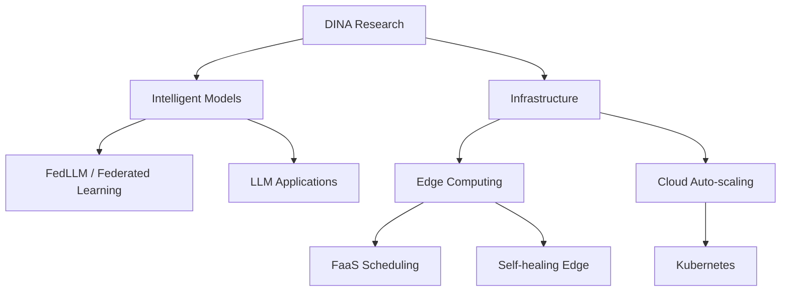

DINA studies intelligent infrastructure from model training to runtime execution — across device, edge and cloud. This post maps our eight research vectors and the threads currently in progress.

## Federated learning objective

In federated learning, $K$ clients collaboratively minimize a global objective without sharing raw data:

$$
\min_{w} F(w) = \sum_{k=1}^{K} \frac{n_k}{n} F_k(w)
$$

where $n_k$ is the sample count on client $k$ and $F_k$ its local loss. Our FedLLM threads (Fed MAB LoRA, Fed + LoRA, adaptive client selection) personalize this objective under communication and heterogeneity constraints.

## Research landscape

## Threads in progress

- **Fed MAB LoRA** — personalized federated fine-tuning with multi-armed bandits.
- **Adaptive code-smell refactoring (CARER)** — LLM-driven refactoring assistance.
- **Auto-scaling on Kubernetes** — workload-aware scaling policies.
- **FaaS scheduling at the edge** — latency-aware function placement.
- **Edge Log** — log analysis framework for edge deployments.

Members, focus areas and talks live on the [people](/people/) page and in [DINA Talks](/posts/dina-talks/).
